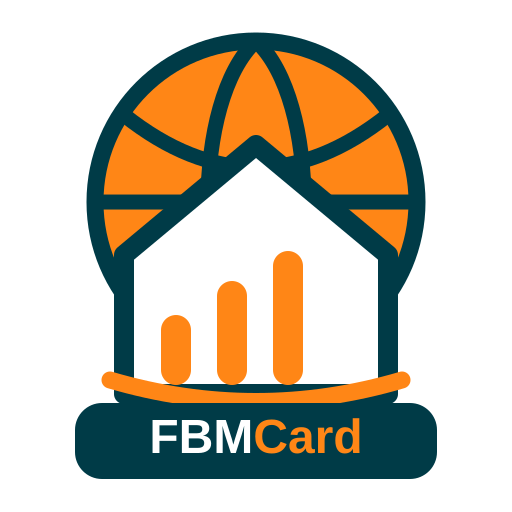
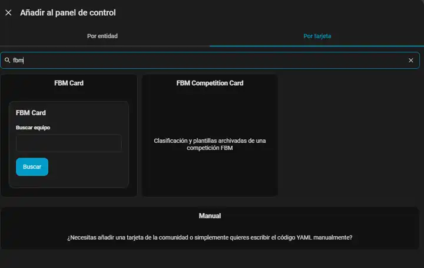
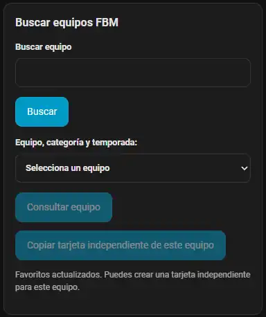
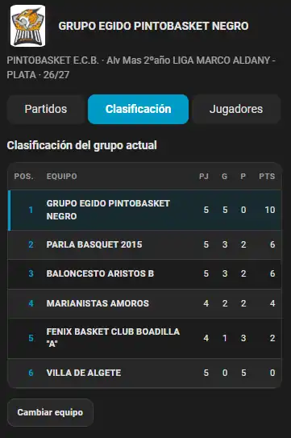
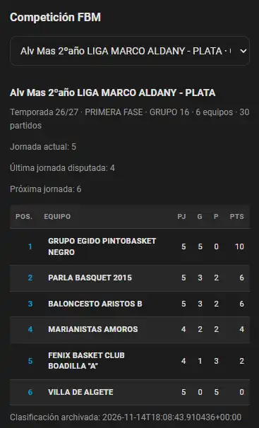

# FBM Card — Baloncesto madrileño en Home Assistant



> **Proyecto comunitario no oficial.** No está afiliado, respaldado ni mantenido por la Federación de Baloncesto de Madrid (FBM).

**Versión estable:** v0.2.12.

FBM Card combina una integración de Home Assistant y tarjetas Lovelace para consultar datos públicos de baloncesto FBM: equipos, competiciones, calendarios, resultados, clasificaciones, plantillas y estadísticas disponibles de jugadores. Está pensada para seguir varias competiciones sin descargar repetidamente datos que no han cambiado.

Al confirmar el seguimiento de una competición, se activa su sincronización automática, incluidas las estadísticas. Si la primera descarga es parcial, las siguientes pasadas continúan en segundo plano.

**Actualización de partidos:** al abrir la pestaña «Partidos» se consultan automáticamente los datos si faltan o necesitan refrescarse; no existe un botón de actualización manual. Se conservan filtros y archivo local. Los marcadores se actualizan en pantalla cuando cambia el archivo local, incluso si la sesión FBM ha caducado. Los grupos con resultados recientes pendientes pueden reconsultarse tras 30 minutos, con un máximo de un grupo por turno de cinco minutos.

## Funciones

- Buscar equipos FBM y guardar favoritos; tarjetas independientes de búsqueda, equipo y competición.
- Consultar los datos deportivos desde cuentas de Home Assistant sin privilegios de administrador; las acciones de configuración, diagnóstico y sincronización manual siguen protegidas.
- Seguir varios grupos y consultar clasificaciones, jornadas, enfrentamientos y resultados oficiales.
- Mostrar escudos de equipos y fotografías de jugadores cuando existan imágenes oficiales verificadas.
- Configurar los ajustes compatibles mediante un editor visual; YAML para opciones avanzadas.
- Archivar datos localmente y actualizar grupos y jugadores de manera incremental.
- Consultar cobertura por grupo: equipos, plantillas archivadas, jugadores con estadísticas completas, pendientes y porcentaje.
- No inventar marcadores, estadísticas, fotografías ni datos ausentes. La disponibilidad depende de FBM.

[Novedades de v0.2.12](RELEASE_0.2.12_NOTES.md)

## Instalación

**Importante: FBM Card todavía no forma parte del catálogo oficial de HACS/Marketplace.** Para instalarla por primera vez debes añadir este repositorio de GitHub como **repositorio personalizado**, de tipo **Integración**.

### Añadir repositorio con un botón

[](https://my.home-assistant.io/redirect/marketplace_repository/?owner=sergey08&repository=Fbm-card&category=integration)

Pulsa el botón, selecciona tu instancia de Home Assistant y sigue el diálogo para añadir el repositorio personalizado. Este enlace está dirigido a **Home Assistant 2026.11 o posterior**. Si utilizas HACS clásico, [abre el repositorio desde HACS](https://my.home-assistant.io/redirect/hacs_repository/?owner=sergey08&repository=Fbm-card&category=integration).

### Instalación manual alternativa

1. Abre **Marketplace/HACS** en Home Assistant.
2. En el menú de los **tres puntos**, selecciona **Repositorios personalizados** (el nombre puede variar según la versión).
3. Añade la URL `https://github.com/sergey08/Fbm-card` y selecciona el tipo **Integración**. Pulsa **Añadir**.
4. Busca **FBM para Home Assistant** entre los repositorios añadidos, descarga la versión estable y reinicia Home Assistant si lo solicita.
5. Ve a **Ajustes → Dispositivos y servicios**, añade **FBM Card (no oficial)**. En **Configurar → Buscar equipo para seguir su competición**, confirma el acceso de invitado si se solicita, busca el primer equipo y selecciona su grupo.
6. La integración registra automáticamente `/fbm_static/fbm-card.js`: **no dupliques el recurso Lovelace**.
7. Añade las tarjetas mediante el **editor visual del panel de control** (instrucciones abajo). No es necesario escribir YAML.
8. Recarga el navegador si sigue mostrando una tarjeta antigua en caché.

### Capturas de pantalla

Imágenes reales de FBM Card funcionando en Home Assistant. El aspecto puede variar según el tema y la versión instalada.

**Añadir una tarjeta desde el panel de control**, sin escribir YAML:



**Buscar un equipo FBM** y crear una tarjeta independiente:



**Tarjeta de equipo**, con las pestañas Partidos, Clasificación y Jugadores:



**Tarjeta de competición**, con la temporada, jornadas y clasificación archivada:



**Actualizaciones:** conserva la identidad invitada y la configuración existente. No elimines ni vuelvas a añadir la integración, ni registres otra vez el dispositivo, solo por actualizar la tarjeta.

## Añadir tarjetas desde el panel de control (sin código)

La forma recomendada de utilizar FBM Card es mediante la interfaz gráfica de Home Assistant:

1. Abre el **panel de control** (dashboard) donde quieras mostrar los equipos o las competiciones.
2. Entra en **Editar panel** y selecciona **Añadir tarjeta**.
3. Abre la pestaña **Por tarjeta** y escribe `fbm` en el buscador.
4. En el selector verás las opciones **FBM Card** y **FBM Competition Card**:
   - **FBM Card**: busca equipos y permite seguir un equipo en una tarjeta independiente, con pestañas **Partidos**, **Clasificación** y **Jugadores**.
   - **FBM Competition Card**: muestra la competición seleccionada, sus jornadas, clasificación y datos archivados disponibles.
5. Selecciona la tarjeta, configura sus opciones con el **editor visual** y guárdala. Puedes añadir tantas tarjetas independientes como necesites.

**No necesitas pegar código YAML** para añadir las tarjetas. La configuración mediante código se mantiene como alternativa para usuarios avanzados o para copiar una configuración existente.

## Configuración avanzada mediante YAML (opcional)

Los siguientes ejemplos son opcionales. Para una instalación normal, usa **Editar panel → Añadir tarjeta → Por tarjeta**.

**Tarjeta de búsqueda** — encuentra un equipo y copia sus identificadores oficiales:

```yaml
type: custom:fbm-card
modo_experimental: true
tipo_tarjeta: busqueda
title: Buscar equipos FBM
id_tarjeta: buscador_fbm
```

**Tarjeta de equipo fijo** — utiliza los valores oficiales copiados del buscador:

```yaml
type: custom:fbm-card
modo_experimental: true
tipo_tarjeta: equipo
title: Mi equipo
id_tarjeta: mi_equipo
equipo_fijo:
  id: "ID_OFICIAL_DEL_EQUIPO"
  nombre: "Nombre oficial del equipo"
  club: "Club"
  categoria: "Categoría"
  temporada: "26/27"
```

Es preferible configurar la tarjeta de competición desde el editor visual, seleccionando una competición seguida. Las opciones disponibles dependen de la versión instalada. No inventes identificadores de competición.

## Sincronización y cobertura

FBM Card guarda los últimos datos archivados y permite actualizar estadísticas de jugadores en lotes limitados. Omite registros completos cuando el número de partidos archivados coincide con las apariciones oficiales y existen puntos por partido. Los jugadores sin apariciones no necesitan consultas de estadísticas de partidos.

La entidad `sensor.competiciones` ofrece el atributo `coverage` con datos por grupo y totales (`teams`, `rosters`, `players`, `complete`, `pending`, `missing_rosters`, `coverage_percent`). El porcentaje mide la **cobertura de las apariciones registradas y archivadas hasta ese momento**, no garantiza que FBM haya publicado estadísticas futuras.

**Validación real (14/11/2026):** cinco grupos seguidos, 30 equipos, 30 plantillas y 321/321 jugadores evaluables completos (100 %) tras una recuperación incremental explícita. Es una fotografía de una instalación concreta, **no un resultado garantizado para todos los usuarios**. La actualización automática tras nuevos partidos sigue pendiente de comprobación.

## Versiones

- **v0.2.10 (estable):** documentación de instalación visual desde el panel, repositorio personalizado obligatorio y cuatro capturas reales en README; sin cambios funcionales.

- **v0.2.9 (estable):** mantenimiento de la documentación publicada en Marketplace; sin cambios en la lógica de FBM Card respecto a v0.2.8.

- **v0.2.8 (estable):** actualización en pantalla de marcadores archivados, incluso con sesión FBM caducada, y reintentos automáticos limitados para partidos recientes sin resultado.
- **v0.2.7 (estable):** alta y reconexión de identidad invitada y recuperación de búsquedas de competición tras cortes de conexión.
- **v0.2.6 (estable):** refresco automático al abrir «Partidos» sin botón manual.

- **v0.2.5 (estable):** identifica claramente la integración como «FBM Card (no oficial)» en Home Assistant y en su configuración, sin cambios funcionales.

- **v0.2.4 (estable):** añade el logotipo para la ficha de detalles de Home Assistant y variantes de alta densidad, sin cambios funcionales.

- **v0.2.3 (estable):** incorpora el icono PNG de FBM Card en la integración de Home Assistant, sin modificar la sincronización ni las tarjetas.

- **v0.2.2 (estable):** sincronización incremental de competiciones y estadísticas de jugadores, diagnóstico de cobertura, tarjetas y editor visual, README en español y logo propio. La validación automática tras la próxima jornada sigue pendiente.
- **v0.2.1 (estable):** mantenimiento de numeración y actualización desde Marketplace.
- **v0.2.0 (estable):** búsqueda, favoritos, clasificaciones, calendarios, plantillas, estadísticas e imágenes oficiales verificadas.

Consulta las [pruebas de GitHub Actions](https://github.com/sergey08/Fbm-card/actions). Las pruebas automáticas no sustituyen la validación funcional en Home Assistant.

## Licencia y atribuciones

El código original de FBM Card se publica bajo la [licencia MIT](LICENSE). La licencia cubre el software propio del repositorio, pero **no concede derechos sobre contenidos de terceros** como los escudos de clubes, las fotografías de jugadores, los datos deportivos, la marca FBM ni el servicio/API de Afición FBM o Gesdeportiva. Estos elementos conservan sus respectivos titulares y condiciones de uso.

FBM Card es un proyecto comunitario **no oficial**, independiente de la Federación de Baloncesto de Madrid. El acceso público o como invitado no implica por sí solo autorización para redistribuir datos o reutilizar una API; consultar las condiciones del proveedor.

## Privacidad, limitaciones y soporte

Este proyecto usa datos deportivos públicos y una identidad invitada FBM compartida. No publiques tokens, datos de registro del dispositivo, información personal ni fotografías de jugadores en incidencias públicas. La disponibilidad de datos, rutas e imágenes oficiales puede cambiar. Para comunicar errores, abre una [incidencia en GitHub](https://github.com/sergey08/Fbm-card/issues) indicando versión de Home Assistant, versión de FBM Card, registros anonimizados y pasos para reproducir el problema.
