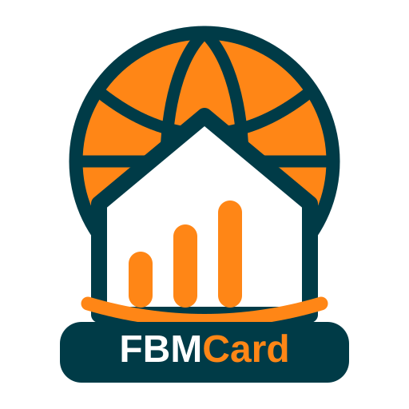

# FBM Card — Madrid Basketball in Home Assistant



> **Unofficial community project.** Not affiliated with, endorsed by, or maintained by the Federación de Baloncesto de Madrid (FBM).

**Stable release:** v0.2.1 · **Development beta:** v0.2.2b28 (tested on Home Assistant, not a stable release).

FBM Card combines a custom Home Assistant integration with Lovelace cards for exploring public FBM basketball data: teams, competitions, fixtures, results, standings, rosters and available player match statistics. It is designed for following multiple competitions without repeatedly downloading unchanged data.

## Features

- Search FBM teams and save favorites; use separate search, team and competition cards.
- Follow multiple competition groups and browse official standings, matchdays, fixtures and results.
- View team crests and player photographs when verified official images are available.
- Use a visual card editor for supported settings; advanced configuration remains available in YAML.
- Archive competition data locally and refresh group and player information incrementally.
- Inspect data coverage for followed groups: teams, archived rosters, players with complete statistics, pending players and percentage.
- Avoid inventing scores, statistics, photographs or missing data. Availability depends on what FBM publishes.

## Installation

1. Add/install **FBM para Home Assistant** through Home Assistant Marketplace/HACS using this repository if necessary.
2. Configure the FBM integration in **Settings → Devices & services** and follow the teams or competitions you need.
3. Restart Home Assistant if prompted. The integration registers `/fbm_static/fbm-card.js` automatically: **do not add a duplicate Lovelace resource**.
4. Add a **FBM Card** from the dashboard card picker and configure it in the visual editor, or use YAML.
5. Refresh the browser if an older card remains cached.

**Updating:** Preserve the existing guest identity and configuration. Do not remove/re-add the integration or re-register the device merely to update a card.

## Cards and example configuration

**Search card** — find a team and copy its official identifiers for a fixed card:

```yaml
type: custom:fbm-card
modo_experimental: true
tipo_tarjeta: busqueda
title: Search FBM teams
id_tarjeta: buscador_fbm
```

**Fixed team card** — use the official values copied from the search card:

```yaml
type: custom:fbm-card
modo_experimental: true
tipo_tarjeta: equipo
title: My team
id_tarjeta: mi_equipo
equipo_fijo:
  id: "OFFICIAL_TEAM_ID"
  nombre: "Official team name"
  club: "Club"
  categoria: "Category"
  temporada: "26/27"
```

The competition card is best configured through the visual editor using a followed competition. Exact available options can vary between stable and beta versions. Avoid guessing competition identifiers.

## Synchronization and coverage (0.2.2 beta)

FBM Card stores the latest archived competition snapshots and supports bounded player-statistics refreshes. Previously complete player data can be skipped when the number of archived match records matches the official appearance count and points are present. Players with zero appearances do not require a match-statistics request.

The `sensor.competiciones` entity exposes a `coverage` attribute with per-group and total counts (`teams`, `rosters`, `players`, `complete`, `pending`, `missing_rosters`, `coverage_percent`). A percentage measures **coverage of the currently archived and reported appearances**, not proof that FBM has published all future statistics.

**Real installation validation (14 Nov 2026):** five followed groups, 30 teams, 30 rosters and 321/321 eligible players complete (100%) after an explicit incremental recovery. This is a single installation's snapshot, **not a guaranteed result for other users**. Automatic post-match refresh must still be checked after the next matchday.

## Releases

- **v0.2.2b28 (beta):** competition/player coverage diagnostics, persisted group/player refresh information and regression tests. Development build, not stable.
- **v0.2.1 (stable):** Marketplace update/versioning maintenance release.
- **v0.2.0 (stable):** initial team search, favorites, standings, fixtures, rosters, player statistics and verified official images.

See [GitHub Actions](https://github.com/sergey08/Fbm-card/actions) for CI. Automated tests do not replace functional validation on a running Home Assistant installation.

## Privacy, limitations and support

This project uses publicly accessible sporting data and a shared FBM guest identity. Do not post tokens, device registration details, personal information or player photographs in public issues. Public availability, endpoints, image URLs and statistics may change without notice. For bugs, open a [GitHub issue](https://github.com/sergey08/Fbm-card/issues) with the Home Assistant version, FBM Card version, anonymized logs and reproduction steps.

---

# FBM Card — Baloncesto madrileño en Home Assistant

> **Proyecto comunitario no oficial.** No está afiliado, respaldado ni mantenido por la Federación de Baloncesto de Madrid (FBM).

**Versión estable:** v0.2.1 · **Beta de desarrollo:** v0.2.2b28 (probada en Home Assistant; no es una versión estable).

FBM Card combina una integración de Home Assistant y tarjetas Lovelace para consultar datos públicos de baloncesto FBM: equipos, competiciones, calendarios, resultados, clasificaciones, plantillas y estadísticas disponibles de jugadores. Está pensada para seguir varias competiciones sin descargar repetidamente datos que no han cambiado.

## Funciones

- Buscar equipos FBM y guardar favoritos; tarjetas independientes de búsqueda, equipo y competición.
- Seguir varios grupos y consultar clasificaciones, jornadas, enfrentamientos y resultados oficiales.
- Mostrar escudos de equipos y fotografías de jugadores cuando existan imágenes oficiales verificadas.
- Configurar los ajustes compatibles mediante un editor visual; YAML para opciones avanzadas.
- Archivar datos localmente y actualizar grupos y jugadores de manera incremental.
- Consultar cobertura por grupo: equipos, plantillas archivadas, jugadores con estadísticas completas, pendientes y porcentaje.
- No inventar marcadores, estadísticas, fotografías ni datos ausentes. La disponibilidad depende de FBM.

## Instalación

1. Instala **FBM para Home Assistant** mediante Marketplace/HACS; añade este repositorio si es necesario.
2. Configura la integración FBM en **Ajustes → Dispositivos y servicios** y sigue los equipos o competiciones deseados.
3. Reinicia Home Assistant si se solicita. La integración registra automáticamente `/fbm_static/fbm-card.js`: **no dupliques el recurso Lovelace**.
4. Añade una **FBM Card** desde el selector de tarjetas y utiliza el editor visual o YAML.
5. Recarga el navegador si sigue mostrando una tarjeta antigua en caché.

**Actualizaciones:** conserva la identidad invitada y la configuración existente. No elimines ni vuelvas a añadir la integración, ni registres otra vez el dispositivo, solo por actualizar la tarjeta.

## Tarjetas y ejemplos de configuración

**Tarjeta de búsqueda** — encuentra un equipo y copia sus identificadores oficiales:

```yaml
type: custom:fbm-card
modo_experimental: true
tipo_tarjeta: busqueda
title: Buscar equipos FBM
id_tarjeta: buscador_fbm
```

**Tarjeta de equipo fijo** — utiliza los valores oficiales copiados del buscador:

```yaml
type: custom:fbm-card
modo_experimental: true
tipo_tarjeta: equipo
title: Mi equipo
id_tarjeta: mi_equipo
equipo_fijo:
  id: "ID_OFICIAL_DEL_EQUIPO"
  nombre: "Nombre oficial del equipo"
  club: "Club"
  categoria: "Categoría"
  temporada: "26/27"
```

Es preferible configurar la tarjeta de competición desde el editor visual, seleccionando una competición seguida. Las opciones pueden variar entre la versión estable y la beta. No inventes identificadores de competición.

## Sincronización y cobertura (beta 0.2.2)

FBM Card guarda los últimos datos archivados y permite actualizar estadísticas de jugadores en lotes limitados. Omite registros completos cuando el número de partidos archivados coincide con las apariciones oficiales y existen puntos por partido. Los jugadores sin apariciones no necesitan consultas de estadísticas de partidos.

La entidad `sensor.competiciones` ofrece el atributo `coverage` con datos por grupo y totales (`teams`, `rosters`, `players`, `complete`, `pending`, `missing_rosters`, `coverage_percent`). El porcentaje mide la **cobertura de las apariciones registradas y archivadas hasta ese momento**, no garantiza que FBM haya publicado estadísticas futuras.

**Validación real (14/11/2026):** cinco grupos seguidos, 30 equipos, 30 plantillas y 321/321 jugadores evaluables completos (100 %) tras una recuperación incremental explícita. Es una fotografía de una instalación concreta, **no un resultado garantizado para todos los usuarios**. La actualización automática tras nuevos partidos sigue pendiente de comprobación.

## Versiones

- **v0.2.2b28 (beta):** diagnóstico de cobertura de competiciones y jugadores, información persistida de sincronización y pruebas de regresión. No es estable.
- **v0.2.1 (estable):** mantenimiento de numeración y actualización desde Marketplace.
- **v0.2.0 (estable):** búsqueda, favoritos, clasificaciones, calendarios, plantillas, estadísticas e imágenes oficiales verificadas.

Consulta las [pruebas de GitHub Actions](https://github.com/sergey08/Fbm-card/actions). Las pruebas automáticas no sustituyen la validación funcional en Home Assistant.

## Privacidad, limitaciones y soporte

Este proyecto usa datos deportivos públicos y una identidad invitada FBM compartida. No publiques tokens, datos de registro del dispositivo, información personal ni fotografías de jugadores en incidencias públicas. La disponibilidad de datos, rutas e imágenes oficiales puede cambiar. Para comunicar errores, abre una [incidencia en GitHub](https://github.com/sergey08/Fbm-card/issues) indicando versión de Home Assistant, versión de FBM Card, registros anonimizados y pasos para reproducir el problema.
